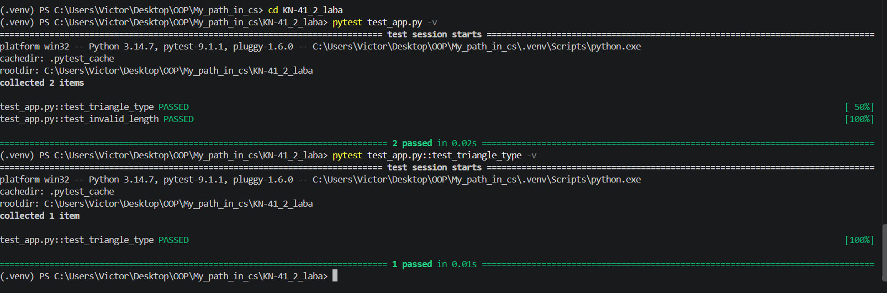
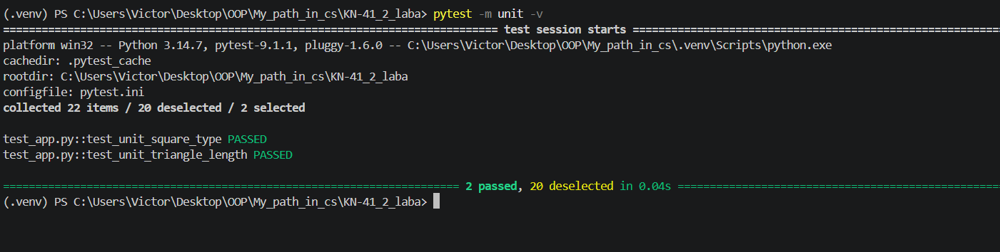
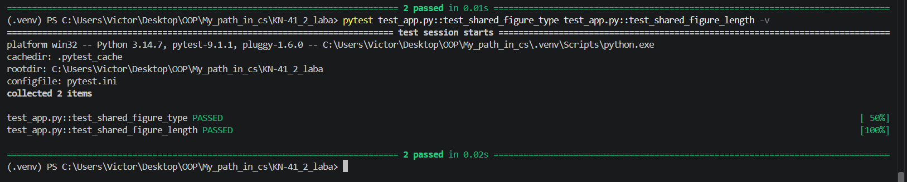
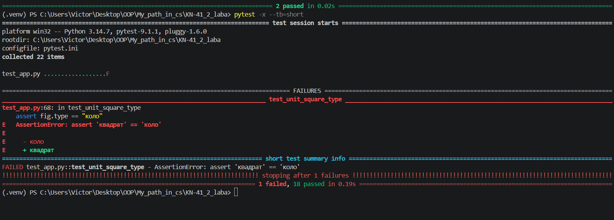
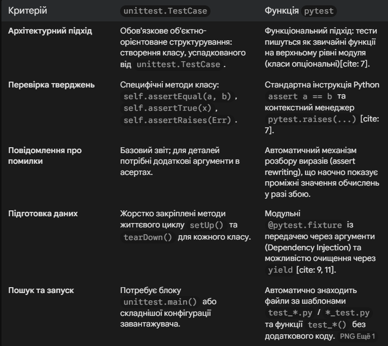

# Звіт до роботи
## Тема: "Тестування з бібліотекою pytest: параметризація, fixtures та маркери"
### Мета роботи: Опанувати основи модульного тестування за допомогою фреймворку pytest, вивчити організацію тестових файлів і функцій, навчитися застосовувати параметризацію тестів, створювати фікстури з різними областями видимості (scope) та фільтрувати запуск тестів за допомогою маркерів;

---
### Виконання роботи
    ✅Під час роботи було виконано всю роботу і навчився працювати з Класами та його основними конструкціями✅.

### Результати виконання Класного завдання№4(Основи) ###

<< Код успішно виконаний >>

---

### Результати виконання Класного завдання(Параметризація та fixtures) ###

<< Код успішно виконаний >>

---

### Результати виконання Індивідуального завдання №7-9 (Детальніше про fixtures) ###

<< Код успішно виконаний >>

---

### Результати виконання Індивідуального завдання №7-9 (Розширені можливості pytest) ###

## Результат виконання завдання №7

## Результат виконання завдання №8

## Результат виконання завдання №9

<< Коди успішно виконаний >>

# Звіт до кінця роботи
## 1.Команда встановлення pytest:
Встановлення бібліотеки у віртуальне середовище (.venv) проекту виконується через пакетний менеджер pip:pip install pytest

## 2.Результат запуску тестів із прапорцем -v:
 

## 3.Порівняння: тест unittest.TestCase та функція pytest
 

## 4.Приклади використання розширених можливостей pytest:

#### А. Параметризація (@pytest.mark.parametrize)- Генерує окремий підтест для кожного значення зі списку

import pytest
from app import Figure
@pytest.mark.parametrize("figure_type", Figure.FIGURES)
def test_all_allowed_figures(figure_type):
    fig = Figure(figure_type, 1)
    assert fig.type == figure_type

#### Б. Фікстури (@pytest.fixture)-Інкапсулює створення об'єкта або ресурсу та передає його в тест через однойменний аргумент

@pytest.fixture
def figure_len_10():
    
    """Створює екземпляр перед виконанням тесту."""
    return Figure("квадрат", 10)

def test_figure_properties(figure_len_10):
    
    assert figure_len_10.type == "квадрат"
    assert figure_len_10.get_figure_length == 10

## Висновки:
- Опанував роботу з тестовим фреймворком pytest, переконавшись у його лаконічності порівняно зі стандартним модулем unittest завдяки використанню звичайних функцій та нативного виразу assert
- Засвоїв принципи організації тестових наборів за шаблонами імен файлів test_*.py та тестових функцій test_*
- На практиці застосував механізм параметризації (@pytest.mark.parametrize) для перевірки списку допустимих і неприпустимих значень без дублювання тіла тесту
- Навчився проєктувати багаторазові фікстури (@pytest.fixture) для підготовки тестових даних та використовувати маркування тестів для їх вибіркового виконання

---

